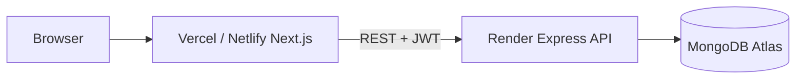

# Doctor Tracker — Deployment Guide

This project is split into two deployable apps:

| App | Recommended platform | Why |
|-----|------------------------|-----|
| **Backend** (`backend/`) | [Render](https://render.com) (free Web Service) | Long-running Express + MongoDB connection |
| **Frontend** (`frontend/`) | [Vercel](https://vercel.com) or [Netlify](https://netlify.com) | Optimized for Next.js |

> **Note:** Vercel is ideal for the **Next.js frontend**. The **Express API** should stay on Render (or similar), not Vercel serverless, because it is a persistent Node server with Mongoose.

---

## Prerequisites

1. **MongoDB Atlas** cluster (free tier is fine).
2. **Network Access** in Atlas: allow `0.0.0.0/0` (or Render’s outbound IPs) so the hosted API can connect.
3. Git repository (GitHub, GitLab, or Bitbucket) connected to Render/Vercel/Netlify.

---

## 1. Deploy backend on Render (free tier)

### Option A — Blueprint (`render.yaml`)

1. Push this repo to GitHub.
2. In [Render Dashboard](https://dashboard.render.com/) → **New** → **Blueprint**.
3. Connect the repo; Render reads [`render.yaml`](render.yaml) at the repo root.
4. Set **secret** environment variables when prompted:
   - `MONGODB_URI` — Atlas connection string
   - `JWT_SECRET` — long random string (`openssl rand -base64 32`)
   - `CLIENT_URL` — your frontend URL(s), comma-separated (see step 2 below)

### Option B — Manual Web Service

1. **New** → **Web Service** → connect repo.
2. Settings:
   - **Root Directory:** `backend`
   - **Runtime:** Node
   - **Build Command:** `npm install`
   - **Start Command:** `npm start`
   - **Health Check Path:** `/api/health`
   - **Plan:** Free
3. **Environment variables:**

   | Key | Value |
   |-----|--------|
   | `NODE_ENV` | `production` |
   | `MONGODB_URI` | `mongodb+srv://...` |
   | `JWT_SECRET` | your secret |
   | `JWT_EXPIRES_IN` | `7d` |
   | `CLIENT_URL` | `https://your-app.vercel.app` (add localhost for local dev if needed) |

4. Deploy and copy the service URL, e.g. `https://doctor-tracker-api.onrender.com`.

### Seed production data (optional)

From your machine (with `MONGODB_URI` pointing at the same Atlas DB):

```bash
cd backend
MONGODB_URI="your-atlas-uri" npm run seed
```

### Verify API

```bash
curl https://YOUR-SERVICE.onrender.com/api/health
```

Expected: `{"status":"ok",...}`

---

## 2. Deploy frontend on Vercel (recommended)

1. [Import project](https://vercel.com/new) from Git.
2. **Root Directory:** `frontend`
3. Framework preset: **Next.js** (auto-detected).
4. **Environment variable:**

   | Name | Value |
   |------|--------|
   | `NEXT_PUBLIC_API_URL` | `https://YOUR-SERVICE.onrender.com/api` |

5. Deploy. Copy the Vercel URL, e.g. `https://doctor-tracker.vercel.app`.

6. **Update Render `CLIENT_URL`** to include the Vercel URL (comma-separated if you also use localhost):

   ```env
   CLIENT_URL=https://doctor-tracker.vercel.app,http://localhost:3000
   ```

7. Redeploy or restart the Render service after changing `CLIENT_URL`.

---

## 3. Deploy frontend on Netlify (alternative)

1. **Add new site** → Import from Git.
2. **Base directory:** `frontend`
3. **Build command:** `npm run build`
4. **Publish directory:** leave default when using Next.js plugin, or use Netlify’s Next.js runtime.
5. Install/build with [`netlify.toml`](frontend/netlify.toml) in `frontend/`.
6. **Environment variable:** `NEXT_PUBLIC_API_URL` = `https://YOUR-SERVICE.onrender.com/api`
7. Update Render `CLIENT_URL` with your Netlify URL, e.g. `https://your-site.netlify.app`.

---

## Environment summary

### Backend (Render)

```env
NODE_ENV=production
MONGODB_URI=mongodb+srv://...
JWT_SECRET=...
JWT_EXPIRES_IN=7d
CLIENT_URL=https://your-frontend.vercel.app,http://localhost:3000
```

`PORT` is set automatically by Render.

### Frontend (Vercel / Netlify)

```env
NEXT_PUBLIC_API_URL=https://your-api.onrender.com/api
```

---

## Free tier limitations

| Platform | Limitation |
|----------|------------|
| **Render free** | Service **spins down** after ~15 min idle; first request may take 30–60s (cold start). |
| **Vercel / Netlify free** | Generous for Next.js; env vars require redeploy to pick up changes. |
| **Atlas free** | Connection limits; ensure IP access is configured. |

For demos and assignments, cold starts on Render are acceptable. For production, use a paid Render plan or always-on hosting.

---

## Troubleshooting

| Issue | Fix |
|-------|-----|
| CORS errors in browser | Set `CLIENT_URL` on Render to the **exact** frontend origin (scheme + host, no trailing slash). |
| Login works locally, not deployed | Check `NEXT_PUBLIC_API_URL` on Vercel/Netlify; rebuild after changing it. |
| API 503 / timeout | Render free tier waking up; wait and retry `/api/health`. |
| MongoDB connection failed | Atlas Network Access + correct `MONGODB_URI` user/password (URL-encode special chars in password). |

---

## Architecture (production)


